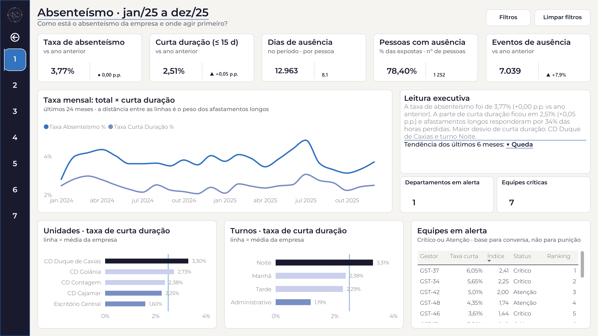
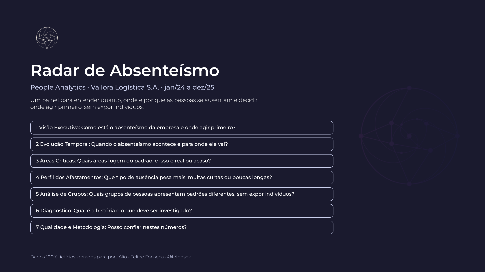
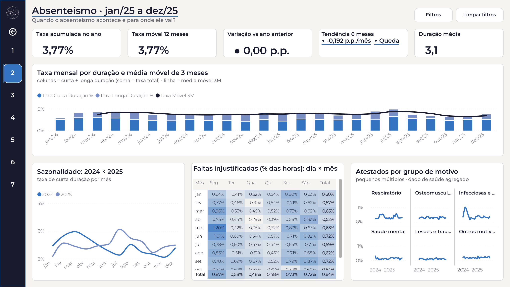
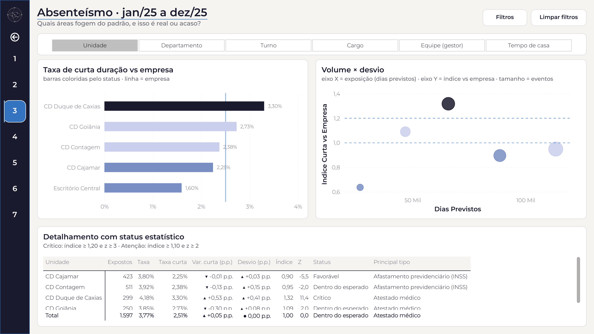
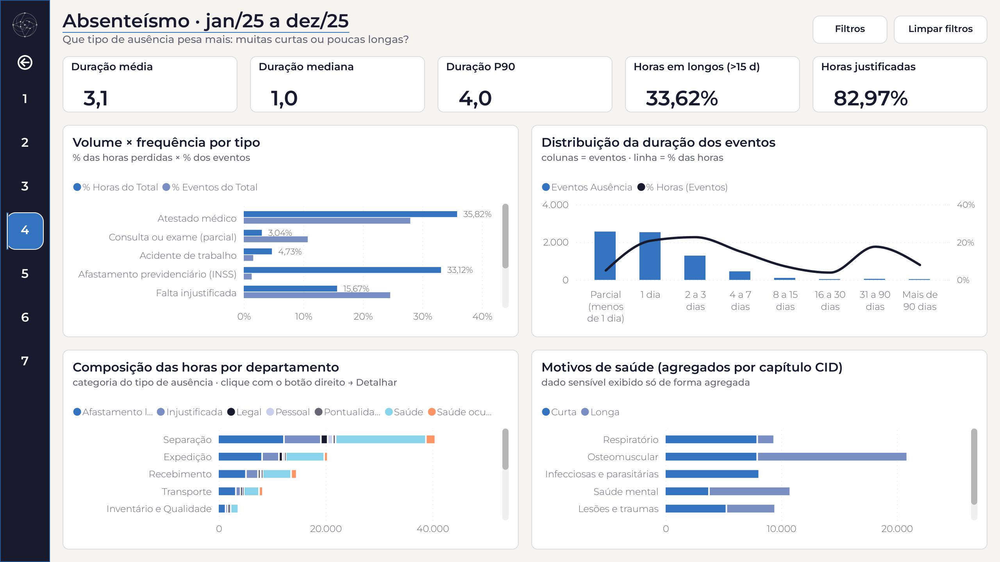
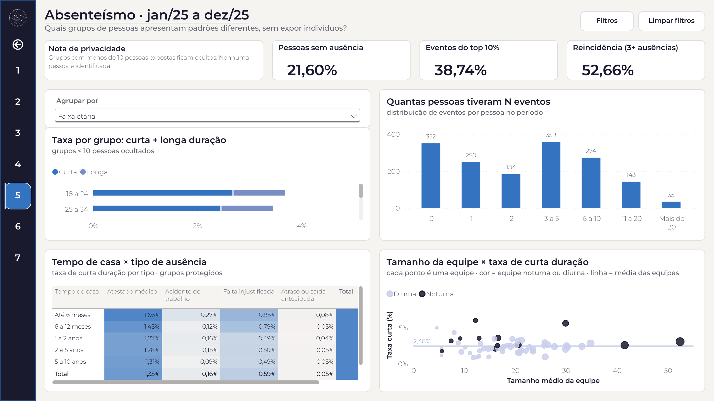
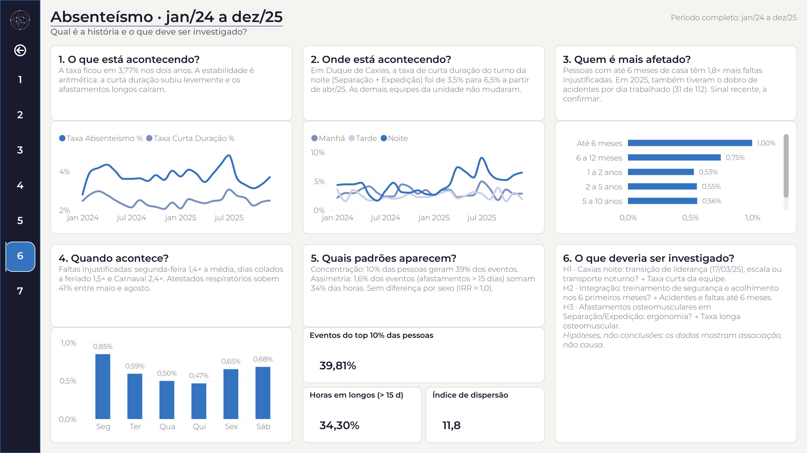
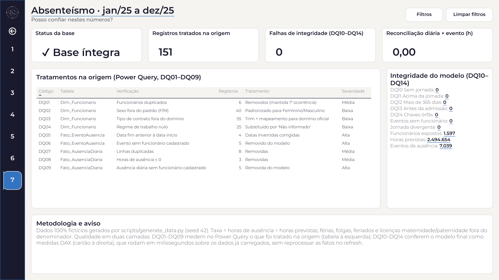

# Radar de Absenteísmo · People Analytics em Power BI

**Um painel de absenteísmo que separa sinal de ruído: decompõe a taxa, testa se os desvios são reais e transforma padrões em hipóteses para investigar, sem expor pessoas.**

> **Dados 100% fictícios.** A Vallora Logística S.A., suas unidades, gestores e funcionários não existem. A base foi gerada para este projeto, com padrões programados e documentados. Nenhum número aqui descreve uma empresa real.

## O problema

A Vallora é um operador logístico com quatro centros de distribuição e um escritório central, cerca de 1.250 pessoas, três turnos e operação seis dias por semana. Cada ausência não planejada vira hora extra ou atraso de expedição.

A diretoria acompanhava um único número: a taxa de absenteísmo. Em dois anos ele ficou parado em **3,77%**, e a leitura era de que o tema estava sob controle. Os gerentes de operação discordavam: falavam em mais faltas no turno da noite e em mais acidentes com gente recém-contratada. O número estava certo e a percepção também. Faltava uma forma de ver as duas coisas juntas.

## O que o painel mostrou

1. **A estabilidade era aritmética.** O fim de um surto de doenças infecciosas e menos afastamentos longos compensaram uma alta de 8% nas demais ausências de curta duração, a parte que o gestor influencia.
2. **A piora tinha endereço.** Em duas equipes do turno da noite do CD Duque de Caxias, uma de Separação e outra de Expedição, a taxa de curta duração foi de 3,5% para 6,5% a partir de abril de 2025 (+82%). O resto da unidade e a noite dos outros CDs não mudaram. As duas equipes tinham trocado de supervisor semanas antes: uma pista para investigar, não uma conclusão.
3. **A noite pesa mais em toda a empresa:** razão de taxas ajustada de 1,31 (IC 95% de 1,23 a 1,39).
4. **Poucos eventos, muitas horas:** 1,6% dos eventos (afastamentos acima de 15 dias) somam 34% das horas perdidas. São dois problemas, com donos diferentes.
5. **Concentração:** 10% das pessoas geram 39% dos eventos, e 22% não tiveram nenhuma ausência. Campanhas para todos atingem sobretudo quem já não falta.
6. **Recém-admitidos** têm 1,8 vez mais faltas injustificadas e, em 2025, o dobro de acidentes por dia trabalhado.
7. **Achados nulos que importam:** a associação entre tamanho de equipe e absenteísmo desaparece quando se separa por turno (confundimento), e não há diferença por sexo.

A conversa muda de "a taxa está estável" para "duas equipes noturnas de Caxias e a integração de novos funcionários precisam de atenção agora", com oito ações direcionadas, cada uma com responsável e indicador de acompanhamento.

| Indicador (empresa) | 2024 | 2025 |
|---|---:|---:|
| Taxa de absenteísmo | 3,77% | 3,77% |
| Taxa de curta duração | 2,45% | 2,51% |
| Taxa de longa duração | 1,32% | 1,27% |
| Eventos de ausência | 6.526 | 7.039 |
| Eventos gerados pelos 10% mais frequentes | 38,0% | 38,7% |

## As telas

Capa e sete páginas, cada uma respondendo uma pergunta. Os filtros globais (ano, mês, unidade, departamento, turno, cargo, equipe e tipo de ausência) ficam num painel lateral recolhível, sincronizado entre as páginas.

| | |
|---|---|
|  **1. Visão Executiva**: como está o absenteísmo e onde agir primeiro? |  **2. Evolução Temporal**: quando acontece e para onde vai? |
|  **3. Áreas Críticas**: quais áreas fogem do padrão, e isso é real ou acaso? |  **4. Perfil dos Afastamentos**: muitas ausências curtas ou poucas longas? |
|  **5. Análise de Grupos**: quais perfis se ausentam de forma diferente, sem expor indivíduos? |  **6. Diagnóstico**: qual é a história e o que investigar? |
|  **7. Qualidade e Metodologia**: posso confiar nestes números? | |

Relatório completo em PDF: [screenshots/radar_absenteismo.pdf](screenshots/radar_absenteismo.pdf). Duas páginas de dica de ferramenta (por área e por mês) e um detalhamento por departamento completam o painel; elas aparecem ao passar o mouse e no clique com o botão direito, e por isso não entram no PDF.

## Como foi construído

- **Dados.** Base gerada em Python com semente fixa, no formato de exportação de um ERP brasileiro: 13 tabelas, 1.826 pessoas, jornada prevista dia a dia (662 mil linhas) e 13,6 mil eventos de ausência. Foram injetados 146 defeitos reais de extração para que o tratamento tivesse algo concreto a resolver.
- **Power Query.** Camada de staging, tratamento de cada defeito e uma tabela de qualidade que mostra o que foi corrigido.
- **Modelo.** Esquema estrela com 3 fatos de grãos diferentes (jornada, ausência diária e evento), 10 dimensões e 28 relacionamentos 1:N, sem filtros bidirecionais.
- **DAX.** 97 medidas: base, KPIs, inteligência de tempo, distribuição, comparação com a empresa, grupos protegidos, narrativa e qualidade. Veja a [amostra de medidas](dax/amostra_medidas.md).
- **Estatística.** Decomposição da taxa, z-score com exposição, modelo binomial negativo ajustado e checagem de confundimento. Detalhes na [metodologia](docs/metodologia.md).
- **Relatório como código.** Uma especificação única, que descreve cada página e visual, gerou a primeira versão do relatório (no formato PBIR do Power BI, validado contra os esquemas oficiais da Microsoft), da documentação e dos wireframes. Depois, o painel foi refinado no Power BI Desktop. Uma auditoria automática continua conferindo que todo visual aponta para medidas e colunas existentes no modelo e que os números citados batem com a base.

**Tecnologias:** Power BI Desktop (Power Query, DAX, RLS, projeto PBIP com relatório PBIR e modelo TMDL) e Python (pandas, NumPy, SciPy, statsmodels).

## Privacidade

A privacidade foi tratada como requisito de desenho, não como ajuste final:

- sem nome, CPF ou e-mail; pessoas aparecem só por código pseudonimizado;
- motivos de saúde apenas agregados por capítulo da CID;
- indicadores por grupo de pessoas suprimidos quando o grupo tem menos de 10 pessoas;
- rankings e alertas por equipe, nunca por pessoa;
- segurança em nível de linha por unidade e por gestor;
- nota explícita de uso não punitivo: os padrões são hipóteses, não provas de causa.

## Documentação

| Documento | Conteúdo |
|---|---|
| [Metodologia](docs/metodologia.md) | Definição da taxa, regras de inclusão, curta e longa duração, regra de alerta, testes estatísticos, privacidade |
| [Dicionário de dados](docs/dicionario_de_dados.md) | Resumo das tabelas do modelo: grão, papel no modelo, relacionamentos principais e volume |
| [Amostra de medidas DAX](dax/amostra_medidas.md) | 8 medidas comentadas |

## Projeto completo

Este repositório é uma vitrine. O projeto completo (arquivo do Power BI, modelo semântico, todas as medidas DAX, consultas do Power Query e gerador de dados) está disponível sob consulta, como template ou com implantação nos dados da sua empresa.

**[Fale comigo](https://orbitaspace.com.br/contato.html)**

## Autor

**Felipe Fonseca** · Orbita Space · Estatístico (UFOP)

[LinkedIn](https://www.linkedin.com/in/fpzfonseca) · [Site](https://orbitaspace.com.br)

---

© 2026 Felipe Fonseca. Todos os direitos reservados. O conteúdo deste repositório pode ser consultado, mas não pode ser copiado, redistribuído ou usado comercialmente sem autorização.
